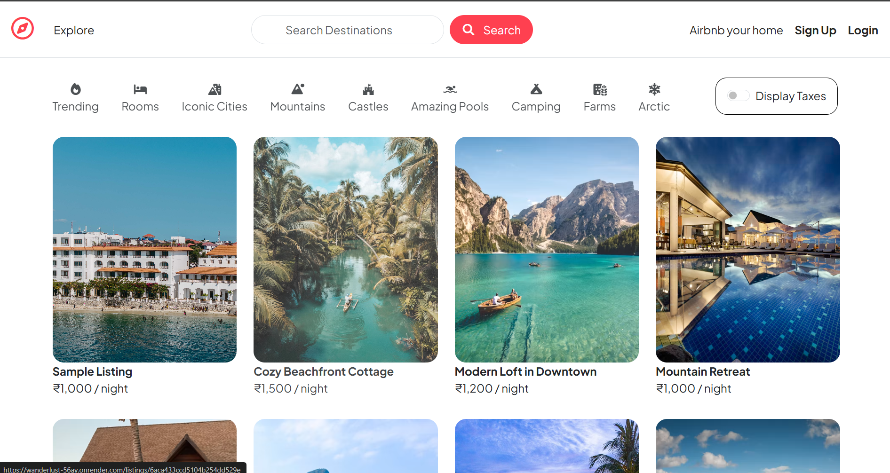
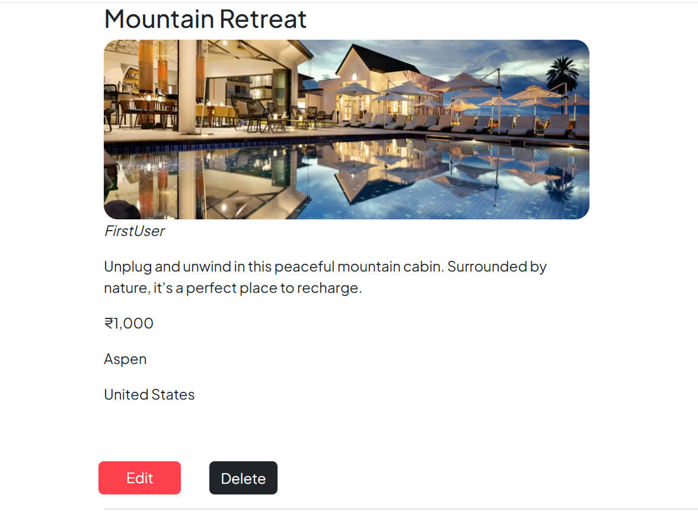
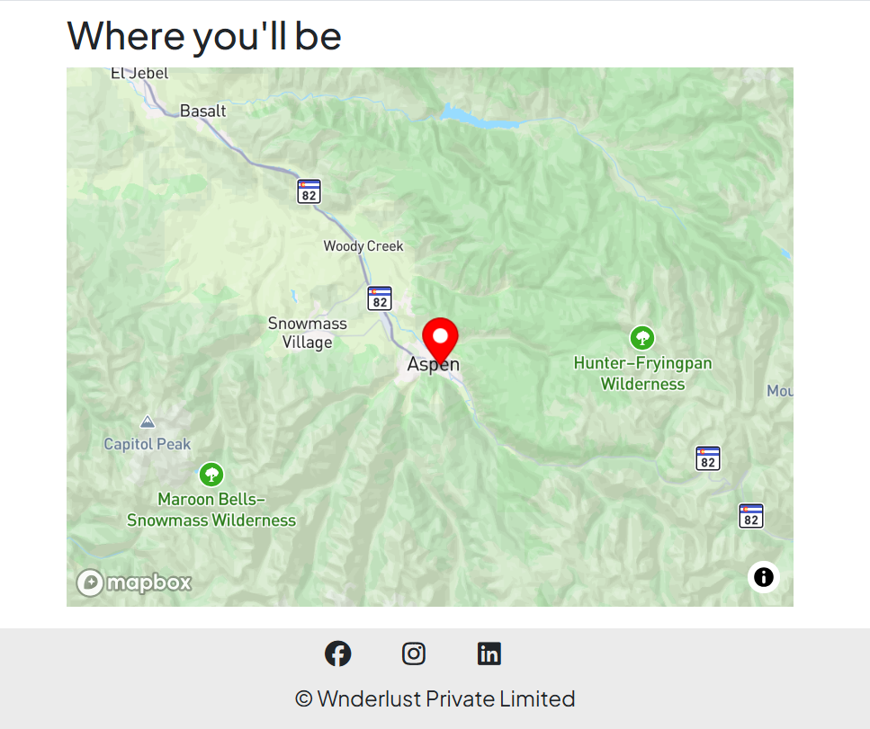
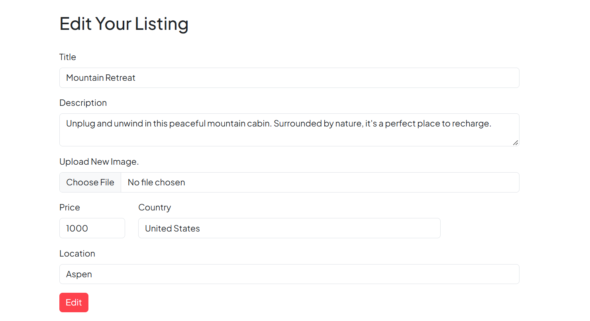

# WanderLust 🏡
### An Airbnb-Inspired Full-Stack Property Rental Platform

**Live Demo:** [Explore WanderLust](https://wanderlust-56ay.onrender.com/listings)

WanderLust is a full-stack web application inspired by Airbnb that allows users to explore property listings, publish their own accommodations, upload property images, and interact with listings through reviews and ratings.

Built using Node.js, Express.js, MongoDB, and EJS, the project focuses on implementing real-world backend architecture, authentication, authorization, database relationships, cloud media storage, server-side validation, and deployment.

## ✨ Key Features

### 🏠 Property Listing Management
- Browse available properties through a centralized listings page.
- View individual property details, including descriptions, pricing, location, country, and images.
- Create, edit, and delete property listings.
- Associate every listing with its owner.
- Automatically obtain geographic coordinates for newly created listings using Mapbox Geocoding.

### 🔐 Authentication and Authorization
- User registration and login using Passport.js.
- Secure password hashing and salting through Passport Local Mongoose.
- Persistent login sessions stored in MongoDB.
- Protected routes for authenticated users.
- Ownership-based authorization to restrict listing modifications.
- Review-author authorization to control review deletion.

### ⭐ Reviews and Ratings
- Submit reviews and ratings for property listings.
- Associate reviews with their authors and corresponding listings.
- Display populated review and author information.
- Delete reviews with appropriate authorization.
- Automatically remove associated reviews when a listing is deleted.

### ☁️ Cloud Image Uploads
- Upload property images using Multer.
- Store uploaded images in Cloudinary rather than relying on local server storage.
- Save image URLs and Cloudinary filenames in MongoDB.
- Support image updates when editing listings.

### 🗺️ Geolocation
- Integrate the Mapbox SDK for location-based geocoding.
- Convert submitted property locations into geographic coordinates.
- Store location data as GeoJSON Point objects, making listings suitable for future map-based discovery.

### ⚡ User Experience
- Server-rendered pages using EJS templates.
- Reusable layouts and template components through EJS-Mate.
- Flash messages for success and error feedback.
- HTTP method overriding to support PUT and DELETE operations through HTML forms.
- Custom error handling and a dedicated 404 response.

## 🛠️ Technology Stack

### Frontend

| Technology | Purpose |
|---|---|
| HTML5 | Page structure and forms |
| CSS3 | Styling and responsive presentation |
| JavaScript | Client-side interactions |
| EJS | Dynamic server-rendered HTML templates |
| EJS-Mate | Reusable layouts and template blocks |

### Backend

| Technology | Purpose |
|---|---|
| Node.js | JavaScript runtime for the server |
| Express.js 5 | HTTP server, routing, middleware, and request handling |
| Mongoose | MongoDB object modeling, schemas, queries, and relationships |
| Passport.js | Authentication framework |
| Passport Local | Username/password authentication strategy |
| Passport Local Mongoose | User registration helpers and password hashing |
| Express Session | Session-based authentication state |
| Connect-Mongo | Persistent session storage in MongoDB |
| Connect-Flash | Temporary success and error messages |
| Method-Override | Enables PUT and DELETE operations through HTML forms |
| Joi | Server-side validation of listing and review input |
| dotenv | Loads environment variables from `.env` during local development |

### Database and Cloud Services

| Technology | Purpose |
|---|---|
| MongoDB Atlas | Cloud-hosted document database |
| Cloudinary | Cloud image storage and delivery |
| Multer | Multipart form handling for image uploads |
| Multer Storage Cloudinary | Connects Multer uploads to Cloudinary storage |
| Mapbox SDK | Geocoding property locations into coordinates |
| Render | Application hosting and deployment |

## 🧩 Architecture and Implementation

WanderLust follows a modular Express application structure, separating routing, controllers, models, validation, middleware, and view rendering.

### Request Lifecycle

1. A user submits a form or navigates to a route.
2. Express routes direct the request to the appropriate controller.
3. Authentication, authorization, and validation middleware run where required.
4. Controllers interact with MongoDB through Mongoose models.
5. External services such as Cloudinary and Mapbox handle image storage and geocoding.
6. EJS templates render the resulting data into HTML.
7. The server returns the rendered page, redirect, or error response.

### Database Relationships

The application uses Mongoose references to represent relationships between its main entities.

- **User → Listing:** Each listing references its owner.
- **Listing → Review:** A listing maintains references to its reviews.
- **Review → User:** Each review references its author.

The listing details page uses Mongoose population to retrieve associated reviews, review authors, and listing owners.

Listings also store images as structured objects containing a URL and filename, while geographic data is stored using GeoJSON.

### Middleware and Validation

The application includes reusable middleware for:

- Checking whether a user is authenticated.
- Preserving the originally requested URL for post-login redirection.
- Verifying listing ownership.
- Verifying review authorship.
- Validating listing and review input using Joi.
- Handling application errors through a centralized error-handling middleware.

These layers help separate access control and validation from the main business logic.

## 📦 Important Dependencies

The following libraries provide the main capabilities of the application:

- **express:** Defines routes and handles HTTP requests and responses.
- **mongoose:** Defines schemas and manages interactions with MongoDB.
- **passport:** Integrates authentication into Express middleware.
- **passport-local-mongoose:** Simplifies local user authentication and password management.
- **express-session + connect-mongo:** Maintains login sessions across requests and persists them in MongoDB.
- **multer + multer-storage-cloudinary:** Handles image uploads and sends files to cloud storage.
- **cloudinary:** Provides the SDK for configuring and interacting with Cloudinary.
- **@mapbox/mapbox-sdk:** Provides the geocoding client used to convert property locations into coordinates.
- **joi:** Validates incoming listing and review data.
- **ejs + ejs-mate:** Render dynamic HTML pages and reusable layouts.
- **connect-flash:** Displays temporary feedback messages after actions.
- **method-override:** Supports update and delete form submissions.
- **dotenv:** Loads local environment configuration.
- **ejs-lint:** Development utility for checking EJS template syntax.

## 🚀 Getting Started

### Prerequisites

Install the following before running the application:

- Node.js and npm
- A MongoDB database, either local MongoDB or MongoDB Atlas
- A Cloudinary account
- A Mapbox access token

### 1. Clone the Repository

```bash
git clone <YOUR_GITHUB_REPOSITORY_URL>
cd WanderLust
```

Replace the repository URL with your actual GitHub repository URL.

### 2. Install Dependencies

```bash
npm install
```

### 3. Configure Environment Variables

Create a `.env` file in the project root:

```env
ATLASDB_URL=your_mongodb_connection_string
SECRET=your_session_secret
CLOUD_NAME=your_cloudinary_cloud_name
CLOUD_API_KEY=your_cloudinary_api_key
CLOUD_API_SECRET=your_cloudinary_api_secret
MAP_TOKEN=your_mapbox_access_token
```

Use your own credentials. Never commit `.env` or expose API secrets in your source code.

### 4. Start the Application

Run the application:

```bash
node app.js
```

The server listens on port `8000` in the current implementation.

Open the application at:

```text
http://localhost:8000/listings
```

Ensure MongoDB is accessible and all required environment variables are configured before starting the server.

## ☁️ Deployment

The application is deployed on Render and uses MongoDB Atlas for cloud database storage.

**Live application:** [https://wanderlust-56ay.onrender.com/listings](https://wanderlust-56ay.onrender.com/listings)

Deployment configuration includes:

- A Render web service for the Express application.
- MongoDB Atlas for persistent application data and session storage.
- Cloudinary for uploaded property images.
- Render environment variables for database credentials, session secrets, and external service credentials.

For deployment, configure the required environment variables in the Render dashboard rather than committing secrets to the repository.

## 🔒 Security Considerations

Security-related implementation includes:

- Password hashing and salting through Passport Local Mongoose.
- Session-based authentication.
- HTTP-only session cookies.
- Ownership and review-author authorization middleware.
- Server-side request validation using Joi.
- Environment-based configuration for sensitive credentials.
- Database-backed session persistence.

These controls help protect user accounts, restrict unauthorized modifications, and validate incoming data.

## 📁 Project Structure

The application separates responsibilities across several modules:

```text
WanderLust/
├── app.js                  # Express application configuration
├── cloudConfig.js          # Cloudinary and upload storage setup
├── middleware.js           # Authentication and validation middleware
├── schema.js               # Joi validation schemas
├── models/
│   ├── listing.js           # Listing schema and review cleanup
│   ├── review.js            # Review schema
│   └── users.js             # User authentication model
├── routes/
│   ├── listing.js           # Listing routes
│   ├── review.js            # Review routes
│   └── user.js              # Authentication routes
├── controllers/
│   ├── listings.js          # Listing business logic
│   ├── reviews.js           # Review business logic
│   └── users.js             # User business logic
├── views/                   # EJS templates
├── public/                  # Static assets
├── utils/                   # Custom error utilities
├── init/                    # Database initialization scripts
├── .env                     # Local environment variables
├── .gitignore
├── package.json
└── package-lock.json
```

*The tree illustrates the intended organization; adjust filenames and directories to match the final repository.*

## 💡 Engineering Challenges Addressed

- Integrating multiple external services into a single Express application.
- Managing relationships between users, listings, and reviews in MongoDB.
- Implementing authentication and resource-level authorization.
- Supporting cloud-based image uploads instead of local file persistence.
- Persisting user sessions across requests and deployments.
- Separating route handling, business logic, validation, and database operations.
- Deploying a database-backed Node.js application to a cloud hosting platform.

## 🔮 Potential Future Improvements

- Interactive maps with property markers and location-based search.
- Search, filtering, sorting, and pagination.
- Booking and reservation workflows.
- Automated tests for routes, controllers, and authentication.
- Rate limiting and stronger production security headers.
- Improved accessibility and mobile responsiveness.
- Continuous integration and automated deployment checks.

## 👨‍💻 About

WanderLust is a full-stack web development project built to practice and demonstrate backend engineering, database modeling, authentication, authorization, file uploads, third-party API integration, server-side rendering, and cloud deployment.

**Explore the live project:** [WanderLust on Render](https://wanderlust-56ay.onrender.com/listings)

## 📸 Screenshots

### Explore Property Listings


### Property Details


### Interactive Map


### Edit Listing


